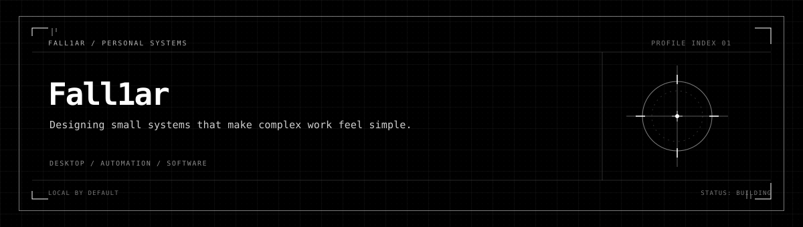
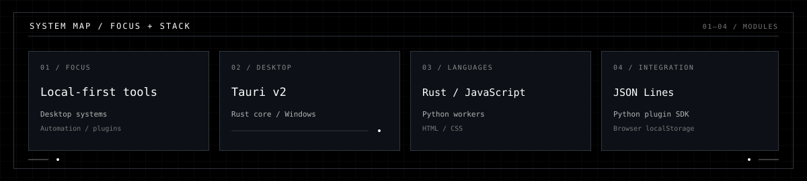
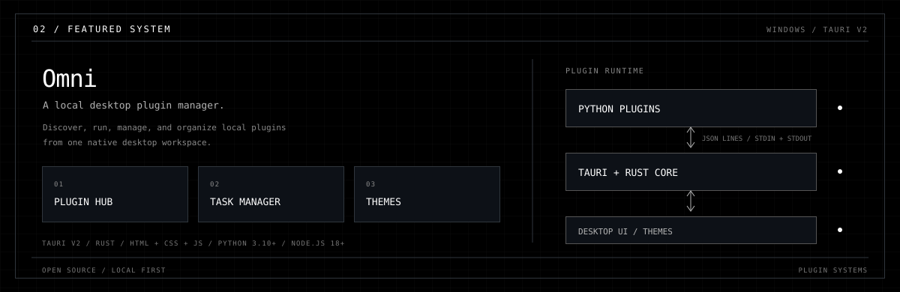

  

  <a href="https://github.com/Fall1ar">PROFILE</a>
  &nbsp;&nbsp;·&nbsp;&nbsp;
  <a href="https://github.com/Fall1ar?tab=repositories">REPOSITORIES</a>

 

## 01 / Focus + Stack

  

## 02 / Featured system

  
   
  <a href="https://github.com/Fall1ar/Omni"><code>OPEN OMNI REPOSITORY</code></a>

## 03 / Activity

  
  

  LOCAL BY DEFAULT &nbsp; / &nbsp; BUILT WITH INTENT

