  

  <a href="https://github.com/Fall1ar">GitHub profile</a>
  &nbsp;&nbsp;·&nbsp;&nbsp;
  <a href="https://github.com/Fall1ar?tab=repositories">Repositories</a>

 

### About / Focus

<table>
  <tr>
    <td width="50%" valign="top">
      <strong>01 — Build</strong> 
      Practical software and small tools that solve real problems.
    </td>
    <td width="50%" valign="top">
      <strong>02 — Design</strong> 
      Clear interfaces, thoughtful details, and useful user experiences.
    </td>
  </tr>
  <tr>
    <td width="50%" valign="top">
      <strong>03 — Automate</strong> 
      Python, connected devices, and LEGO SPIKE robotics.
    </td>
    <td width="50%" valign="top">
      <strong>04 — Explore</strong> 
      Android, Java, Kotlin, and the space between hardware and software.
    </td>
  </tr>
</table>

### Tech Stack

  
  
  
  
  
  
  

### GitHub Stats

<table>
  <tr>
    <td width="50%" align="center">
      
    </td>
    <td width="50%" align="center">
      
    </td>
  </tr>
</table>

  Tools with purpose. Interfaces with intent.

